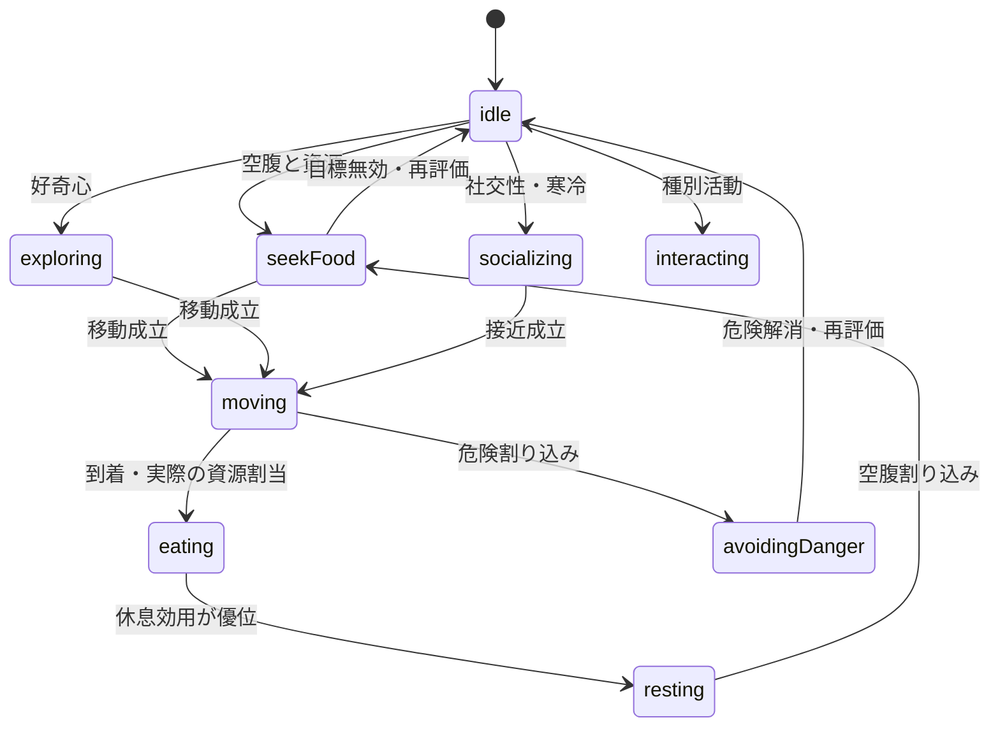

# Phase 2–4 設計（v0.12.0 候補）

調査基点は origin/main `81da4eecbfb639cb702b0777247d5587eb676aed`（v0.11.0）。本番デプロイは未実施。数値結果と実施状況は [検証報告](report.md) を参照。

## 変更前後

変更前も Python/NumPy → Pyodide Worker → Three.js の構成。固定日次ステップ、300/15秒の時間管理、速度変更バリア、共有アトラスは導入済みだった。行動は固定スコアによるラベル付けが中心で、個性と保持される目標がなく、猫ごとに非表示の Sprite/Material を確保していた。

変更後は Python の Utility/FSM が性格・意図・目標・期限を所有する。Ecology が移動可否と採食・資源配分・繁殖・死亡の唯一の決定者。Worker は確定状態と日内移動計画を通知し、Presentation が表示座標・演出時計・アニメーション状態を所有する。Three.js は軽量レコードを共有 InstancedMesh へ転送する。画面外でも Python の計算条件は同じ。

## 行動AI

`configs/species/behavior.json` の係数と保持日数を `eco.behavior_config` に保存する。生態系パラメータとは別設定。性格は好奇心・社交性・警戒心（0以上1未満）。counter RNG の専用 stream 12 に seed、個体ID、出生惑星日を与える。既存 stream は変更しない。探索先選択は stream 13。性格・行動・設定を保存し、旧セーブでは最初の論理ステップに決定論的に補完する。

採食、休息、探索、交流、危険回避、種別活動を評価する。空腹・資源、疲労、温度、水分・水深、近傍個体、性格を参照する。ヒステリシスは既存候補との差が設定値以上の場合だけ切替を許す。空腹/ストレスの緊急閾値はこれを無視する。目標と `since`、`duration`、`nextDecisionDay`、`targetId` を保持し、通常3–4日の期限をIDで分散する。安全な継続中は空間探索とスコア再計算を省く。食物消失、対象死亡、地形/障害物の無効化、環境区分の変化で再評価する。

### FSM 条件

| 状態 | 開始 | 継続/完了 | 中断 |
|---|---|---|---|
| idle | 他候補が低い | 次回判断まで待機 | 緊急・環境変化 |
| seekFood | 空腹の効用最大/緊急 | 有効な食物目標を保持 | 食物消失・期限・危険 |
| moving | 生態系の移動が実際に成立 | 日内経路完了で到着 | 次の確定状態へ同期 |
| eating | 実際の割当で摂取量>0 | 日次資源取引で完了 | 次の判断/継続意図に戻る |
| resting | 疲労・満腹時に効用最大 | 保持期限まで | 空腹・危険 |
| exploring | 好奇心・探索効用最大 | 目標到着/期限 | 食物・危険・目標無効 |
| socializing | 社交性・近傍・ふわふわの寒冷効用 | 対象の存在と期限 | 対象死亡・危険 |
| avoidingDanger | ストレス閾値超過/危険効用最大 | 温度負荷の小さい有効セルへ | 危険解消後に再評価 |
| interacting | 光合成/分解/知恵等の効用 | 種別の既存処理を継続 | 期限・空腹・危険 |

移動確率・天候による活動率・斜面・水域・障害物の既存制約を保持する。探索/交流は満腹側のもぐもぐ/ふわふわの候補地に反映する。採食・分解・魚・鳥の候補地順位は既存の利用可能量評価を優先する。休息の意図を、全種の採食機会を遮る追加ルールにはしない。これは前回確認された分解者の移動停止退行を避けるためであり、行動名で資源収支を書き換えないためでもある。

草は既存の光合成、もぐもぐは生成G、きのこ/スライムはO/R、ふわふわはOのgleanと寒冷集合、魚は水域、鳥は広域飛行・運搬、知恵は300日周期を維持。全個体をID順に正規化して比例配分する。今回、寿命・繁殖・採食・分解の数値係数は変更しない。能動コードに存在しない遺伝子/第9種を新設しない。

## 描画状態

CatSimulationState は Worker の `cats` に含まれる ID、sp、j/i、age、energy、mass、action、behavior、goals、personality。生死は生存配列への所属と出生/死亡イベントで表す。

CatPresentationState は `Presentation.live` の ID割当レコード。x/y、targetX/Y、heading、goalコピー、phase/gait、animation、animationStart、progress、spriteFrame、priority、selected、scaleX/Y、rotation、bornAt を保持する。再利用時は全フィールドを消去して初期化する。goal 配列はコピーし、生態系オブジェクトを逆更新しない。静止画像のため spriteFrame は0。方向はカメラ相対8方向のアトラス列に変換する。

| 倍率 | 秒/惑星日 | 座標反映 | 歩行 |
|---|---:|---:|---|
| 観察0.05 | 300 | 25msの論理時刻サンプル＋描画フレーム | 0.25m/実秒、距離でgaitを計算 |
| 1 | 15 | 4Hz | 即時再配置 |
| 5 | 3 | 3Hz | 即時再配置 |
| 10 | 1.5 | 2Hz | 即時再配置 |
| 20 | .75 | 2Hz | 即時再配置 |
| 100 | .15 | 1Hz | 即時再配置 |

1惑星日は既存の整数日次資源取引。48日=生物学的1歳、季節360日は別概念。観察ではエンジンが1日分を隔離コピー上で計算し、移動と摂取時刻を予約する。移動は日初から75m/惑星日で進み、到着後は待機、実際の摂取は日末の確定取引。描画は終わりの1実秒を採食姿勢に使う。出生・死亡は確定境界のみ反映する。隔離コピーも同じ開始状態から因果順に計算し、日末結果をその日の意思決定へ戻さない。プレイヤーが世界を変えた場合は未確定コピーを破棄。コミット時はこの計算を採用し、二重計算しない。描画の有無で結果は変わらない。

日内座標は生態系のセル占有を置き換えず、エンジン所有の連続経路サンプルとして表す。個体間の連続衝突や日内の採食再配分は今回導入しない。正式な足運びフレームは素材待ち。

速度変更は現ステップ終了→計算/演出停止→確定スナップショット→生死/位置/方向/行動の同期→新速度/未処理時間破棄→同期フレーム→再開。元の停止状態を維持。連続要求は最新値へ統合し、完了直前の要求や失敗後の再要求も取りこぼさない。

## リソース所有権と最適化

アトラスの Texture/Material は World が1組所有し、カメラ操作や個体死亡では破棄しない。個体の表示レコードには GPU Material を割り当てない。共有 InstancedMesh は初期16、必要数の次の2冪まで拡張（500匹では512）。拡張時は旧geometry/instance bufferのみ解放し、共有material/textureを維持。空きCPUレコードは現在個体数程度に制限する。遠方は微動を省略、視錐台外は描画行列の転送対象から除外する。

GLBモデルはPromiseキャッシュを共有し、配置コピーは借用する。配置マーカーのみ配置側が所有し、撤去/新世界でgeometry/materialを解放する。読み込み待ちで撤去されたオブジェには後からモデルを追加しない。

空間インデックスはセル分割、最近傍の同距離は最小IDで決定。NumPy参照実装との一致を検証する。表示可視範囲は空間インデックスに渡さない。

オフラインの自動進行は有効化しない。headless の step、保存継続、未処理イベントはテスト対象。将来の選択待ちイベントはプレイヤー入力として記録して止める必要があるが、現行の知恵イベントは自動処理で選択待ちを持たない。
