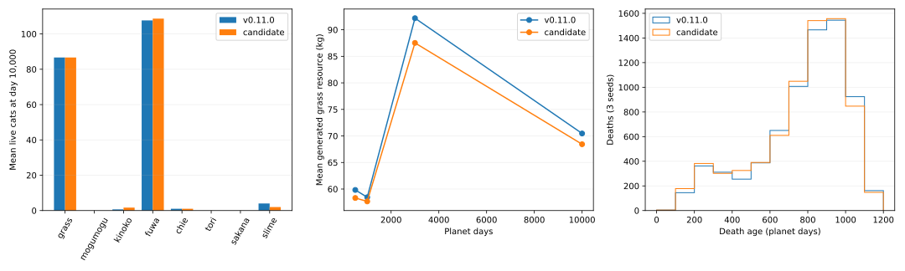
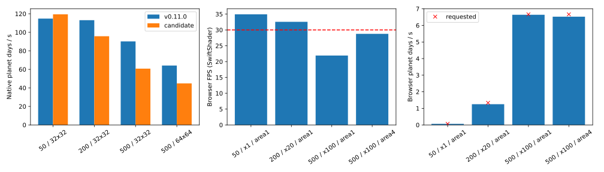

# Phase 2–4 実装・検証報告（v0.12.0 候補）

基点: `81da4eecbfb639cb702b0777247d5587eb676aed`。本番は v0.11.0 のまま。本変更は未デプロイ。

## 判定

- Phase 2: 行動AIと保存の機能テスト完了。生態系の数値係数は維持したが、移動選択の変更で種別構成・死亡率に差がある。数値を以前と同じにする保証ではない。
- Phase 3: 状態分離、観察経路、速度別再配置、切替、欠損素材フォールバック、簡易演出の検証完了。正式な足運び・まばたき・尻尾・死亡フレームは素材不足で未実装。Phase全体の完全完了とはしない。
- Phase 4: プール、共有リソース、空間探索、負荷・メモリ試験を実施。500匹のブラウザFPSは目標未達。性能条件を満たすPhase全体の完了とはしない。

[設計・FSM遷移図](design.md) / [正式アニメーション制作リスト](animation-assets.md)

## 実行と結果

`npm test`: JavaScript 15 + 追加/統合Python 34 + 既存Python 51 = **100成功・0失敗・0スキップ**。変更前80成功。実ログ: [tests.txt](results/tests.txt)。途中で検出した状態名の旧期待値とNumPy整数のJSONエラーは修正後に再実行した。

`npm run test:browser`: PC 1440×1000 / mobile 390×844 の2シナリオ成功。起動、観察座標一致、連続切替、手動停止維持、×100、保存復元、再起動を検証。どちらも通常実行のHTTP/console/pageエラー0。端末実機ではなくChromium/SwiftShader。スクリーンショットはローカル artifacts/desktop-*.png と mobile-*.png。

`node tests/phase234-browser.mjs`: 欠損PNG1枚で起動継続、カメラ/ズーム/大量割当で世界ハッシュ不変、観察/×100の60日後ハッシュ一致、実GLBの配置・保存復元・撤去、500匹高速再生中の保存と速度変更/停止を確認。[結果](results/browser-edge.json)。意図した画像ロード失敗以外の致命的エラー0。

`python scripts/measure-ecology.py --root /tmp/necosmos-phase234-baseline --out artifacts/phase234/before.json` と `python scripts/measure-ecology.py --out artifacts/phase234/after.json`: 各3シード、各10,000日、合計60,000日。500/1,000/3,000/10,000日の24チェックポイントを保存。[全比較データ](results/balance.json)。ベースラインはgit archiveで上記HEADを独立展開。長期実行のwall timeは他テストと競合したため性能値には使わない。

再現性: 全個体配列、行動/性格/設定、資源、天候・カウンタ乱数入力、出生/死亡履歴を含むシリアライズ済み世界を比較。6速度で同じ360日、100/200日で同じ拡張操作が一致。描画なし/日内計画あり、配列順序変更、空間インデックス/NumPy参照で一致。異なるFPSは論理時計の15/30/60/144FPS分割テスト。ブラウザ全体を全FPSに固定しての長期走行は未実施。異なるNumPy実装/機器間のビット単位一致を保証する試験ではない。

保存互換: 実際の旧コミットd6cb936(v0.10.0) / fdb6566(v0.10.1)由来のセーブfixtureで検証。v0.10.1は読み込み直後の旧ハッシュも一致。v0.10.0は既存の天候移行を適用し、全資源・地形・個体配列を保持。旧天候履歴は捏造せず、保存日から現在方式へ移行。新AI状態を保存復元後、継続計算が完全一致。表示一時状態は保存しない。v0.11.0のUIメタも受理。オフライン自動進行は無効のまま。

## 生態系比較

hills/wet/all8、cap200、固定生息域、seed21001〜21003。平均寿命は死亡個体の観測年齢であり、存命個体を含めた完全な寿命推定ではない。

| seed | 前/後 | 出生総数 | 死亡総数 | 死亡平均年齢(日) | 老衰以外 | day10,000 草/ふわ/きのこ/スライム |
|---|---|---:|---:|---:|---:|---|
| 21001 | 前 | 2558 | 2387 | 781.7 | 18.6% | 72/127/0/0 |
| 21002 | 前 | 2574 | 2403 | 777.1 | 19.0% | 91/102/2/4 |
| 21003 | 前 | 2604 | 2433 | 766.2 | 20.1% | 97/94/0/8 |
| 21001 | 後 | 2617 | 2446 | 766.9 | 22.0% | 63/131/5/0 |
| 21002 | 後 | 2609 | 2438 | 766.7 | 20.7% | 113/80/0/6 |
| 21003 | 後 | 2622 | 2451 | 764.0 | 20.6% | 84/115/0/0 |

| 種 | 平均出生 前→後 | 平均死亡 前→後 | 10,000日時点の共存シード数 前→後 |
|---|---:|---:|---:|
| grass | 1417.0→1468.3 | 1340.3→1391.7 | 3/3→3/3 |
| mogumogu | 3.0→24.0 | 6.0→27.0 | 0/3→0/3 |
| kinoko | 72.3→170.7 | 74.7→172.0 | 1/3→1/3 |
| fuwa | 897.3→804.7 | 792.7→699.0 | 3/3→3/3 |
| chie | 0.0→0.0 | 0.0→0.0 | 3/3→3/3 |
| tori | 2.0→1.3 | 5.0→4.3 | 0/3→0/3 |
| sakana | 0.3→0.7 | 3.3→3.7 | 0/3→0/3 |
| slime | 186.7→146.3 | 185.7→147.3 | 2/3→1/3 |

出生率/死亡率は比較JSONに出生/惑星日・死亡/惑星日として収録（各10,000日が分母）。個体当たりのhazard推定とは区別する。

| day/版 | 平均energy | G | O | R | N | 土壌水Ws | 地表水h | 平均温度℃ | 水分 |
|---|---:|---:|---:|---:|---:|---:|---:|---:|---:|
| 500/前 | 362.549 | 59.828 | 133.616 | 29.280 | 550.517 | 44.956 | 0.923 | 30.37 | 0.364 |
| 500/後 | 361.388 | 58.313 | 137.006 | 28.957 | 549.296 | 44.900 | 0.878 | 30.37 | 0.364 |
| 1000/前 | 499.986 | 58.448 | 148.622 | 23.131 | 521.282 | 54.347 | 0.743 | 15.87 | 0.437 |
| 1000/後 | 512.129 | 57.668 | 161.870 | 23.171 | 511.981 | 54.171 | 0.673 | 15.86 | 0.436 |
| 3000/前 | 630.001 | 92.181 | 237.821 | 12.013 | 342.068 | 64.310 | 6.036 | 30.27 | 0.528 |
| 3000/後 | 599.757 | 87.523 | 244.604 | 12.018 | 338.835 | 64.058 | 5.968 | 30.26 | 0.528 |
| 10000/前 | 510.557 | 70.465 | 430.594 | 5.808 | 134.202 | 80.369 | 8.858 | 15.04 | 0.711 |
| 10000/後 | 470.942 | 68.438 | 459.139 | 5.809 | 128.798 | 80.328 | 8.856 | 15.04 | 0.711 |

全滅/peak/種別共存率は比較JSONの全シード値を参照。主要死因は老衰と飢餓。移動先/継続/危険回避が変わり、同じ収支式でも利用する資源と共有上限の出生競合が変わる。原因を各要素に定量分解するablationは未実施。共存率と老衰以外の死亡割合の差は、次のバランス検討で扱う。今回、寿命/繁殖/資源係数を調整して結果を隠していない。

草ねこ・ふわふわねこが多い理由: 草の初期数10対多くの他種3、繁殖開始7日対主に48日、repro_base .07、光合成による継続供給。ふわふわはOをgleanして得るエネルギーに対してdaily_costが小さく、寒冷集合で損傷が軽減される。両種が先に共有capの枠を取る。これは既存係数と生息条件による傾向で、種別頭数を直接増やす新倍率は追加していない。

エネルギー、G/O/R/N、土壌/地表水、温度・水分、種別出生/死亡、死因、年齢分布の値を比較JSONに収録。資源の保存則は既存の水/土砂/物質収支テストと空資源時のエネルギー非獲得テストで検証。長期比較の全日残差は保存していない。

## 性能

環境: Linuxコンテナ、CPU quota2、Python/NumPy、Chromium/SwiftShader。スマートフォン実機/GPU実機は利用不可。nativeの100日測定は他の負荷実行を止めて各条件で実行。Native列のsimulationは天候/水/地形/生態系を含む。kernelはEcology.step、AIはその内数。ブラウザ通信は送信後往復からWorker処理を差し引く（キュー待ちは含めない）。GPUは非同期EXT_disjoint_timer_query_webgl2、無効/未完了サンプルは採らない。CPU submit時間と区別する。

| 初期匹数/面積 | Native 前→後 日/秒 | 後 simulation ms/日 | 後 ecology kernel ms/日 | 後 AI ms/日 |
|---|---:|---:|---:|---:|
| 50/1 | 114.8→119.4 | 8.38 | 2.27 | 0.83 |
| 200/1 | 113.1→95.7 | 10.44 | 4.84 | 2.53 |
| 500/1 | 90.2→60.7 | 16.46 | 10.65 | 5.99 |
| 500/4 | 64.1→44.9 | 22.29 | 12.50 | 7.49 |

| 初期匹数/面積/速度 | FPS | 実効日/秒 | simulation/Worker/通信 ms※ | GPU ms | 猫CPU animate+batch ms | 地形更新 ms※※ | 入力→次フレーム中央値 ms |
|---|---:|---:|---:|---:|---:|---:|---:|
| 50/1/×1 | 34.9 | 0.064 | 91.70/144.40/1.00 | 9.60 | 0.10 | 1.60 | 56.40 |
| 200/1/×20 | 32.6 | 1.249 | 75.10/100.10/1.85 | 9.36 | 0.10 | 1.00 | 17.00 |
| 500/1/×100 | 21.9 | 6.641 | 87.65/118.25/2.80 | 18.22 | 0.40 | 0.80 | 25.50 |
| 500/4/×100 | 28.8 | 6.527 | 149.15/209.30/2.30 | 9.09 | 0.20 | 2.50 | 13.80 |

※ 各採取時点の直近バッチの中央値。最大面積は複数日をまとめたバッチを含むため、そのまま1日あたりと比較しない。※※ 地形値も直近更新時間。CPU WebGL submit中央値は約0.2ms。通信にはstructured clone/イベントループ待機を含む。入力は診断APIのカメラ変更から次rAFまでで、物理タッチのend-to-end遅延ではない。

通常/中負荷は30FPSを上回ったが、高負荷は未達。500匹・標準面積の実効はほぼ要求6.67日/秒。4倍面積では若干低下し、UIは設定速度と実効を分ける。主な制約はWASM計算/状態シリアライズとソフトウェアGPUのCPU共有。猫行列更新や通信だけが支配的という結果ではない。計算日は飛ばさない。

| 匹数 | セル索引 最近傍 μs | NumPy参照 μs | 結果一致 |
|---|---:|---:|---|
| 50 | 4.55 | 7.91 | yes |
| 200 | 2.23 | 9.42 | yes |
| 500 | 1.94 | 10.53 | yes |

| 初期匹数/面積 | Main JS heap MiB | Worker WASM MiB | 全Chrome PSS MiB | 直近の表示割当 ms |
|---|---:|---:|---:|---:|
| 50/1 | 11.00 | 34.62 | 528.37 | 0.100 |
| 200/1 | 15.25 | 34.62 | 558.27 | 0.000 |
| 500/1 | 32.47 | 41.56 | 613.80 | 0.500 |
| 500/4 | 39.79 | 49.88 | 683.72 | 0.200 |

参照実装は座標配列をキャッシュし、距離をNumPyで一括計算する。全問で同距離時のID優先まで一致。測定条件ではセル索引が速いため維持。[測定値](results/spatial.json)。

メモリ: 4回×100フレームの50↔500匹再割当、約90,000回の表示割当後もtexture=1、geometry=4、capacity=512。個体ID重複/再利用残留は自動テスト。GC後JS heapは 8.10→7.82→7.78→7.80 MiBで単調増加なし。これは数分の試験であり数日連続稼働のリーク保証ではない。ネイティブ10,000日×6は異常終了なし。WASMヒープとブラウザ全体PSSは[生データ](results/browser-performance.json)に別記。共有GLBの借用リソースと所有マーカーを分けて解放する。

## 残存項目

- 正式な歩行/目/尻尾/死亡アニメーションと実機での自然さの受入。[素材リスト](animation-assets.md)。簡易変形で代替した動作を正式フレームと報告しない。
- 500匹の30FPS、および4倍面積×100の安定した6.67日/秒。今後はWorkerの差分転送、地形更新頻度/LOD、実GPU測定を検討する。日内足元一致を壊す粗い地形化は今回採用していない。
- 数日間連続のブラウザメモリ、スマートフォン実機、異機器/異NumPy間のビット再現性は未検証。
- 3シード/単一長期環境のバランス試験は全気候での共存保証ではない。種別共存率差の要因別検証と調整は別途必要。
- 選択待ちオフラインイベントの新仕様と自動進行は未実装・本番無効。既存の知恵300日処理は回帰テスト対象。
- 本番デプロイ未実施。結果報告後の承認が必要という今回の指示を維持する。

## 主な変更ファイル

`ecosystem/behavior.py` / `configs/species/behavior.json`: Utility/FSM/性格/目標。`cats.py`: 意思決定接続と実際の移動/採食状態。`spatial.py`: 決定論的NumPy参照。`coupling/simulation.py`: AIを再現ハッシュに含む。`public/engine/bridge.py`: 状態転送と診断世界/計測。`public/js/presentation.js`: 表示状態と実時間簡易演出。`render.js`: プール/共有アトラス/欠損時代替/所有権/可視範囲/GPU計測。`main.js` / `worker.js` / `time.js`: 通信計測/診断API/不要UI再生成抑制/切替競合修正。`build-release.py`: AI設定をWorkerへ配布。対応するpublic/engineコピーとmanifestを更新。tests/ と scripts/ に検証を追加。バージョン表示は候補0.12.0。

[完全な変更ファイル一覧](results/changes.txt)。同一ブランチのgit diff --name-only origin/mainでも確認できる。公開版へ自動反映するmainへのpush/mergeは行っていない。

## 追加の観察性能

50匹・観察モード8秒サンプルは 35.9FPS、日内時刻からの実効 0.003336日/秒（要求1/300）。短時間試験なので日末の資源取引はまだ発生しない。300秒/日の換算は固定時計テスト、日内歩行はブラウザ座標照合で別々に検証。[測定値](results/observation-performance.json)。
